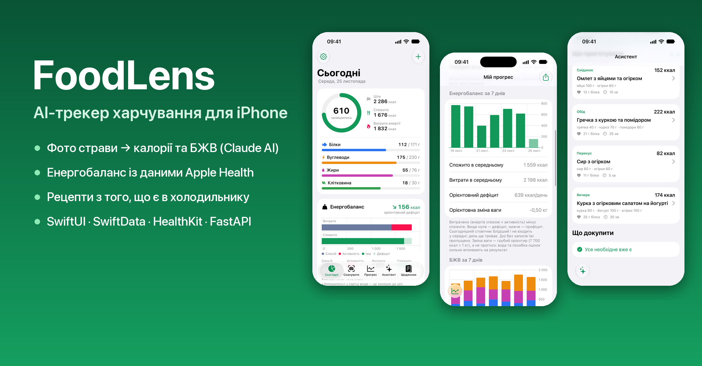
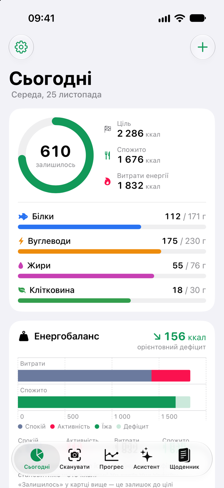
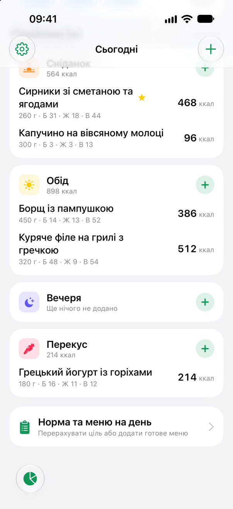
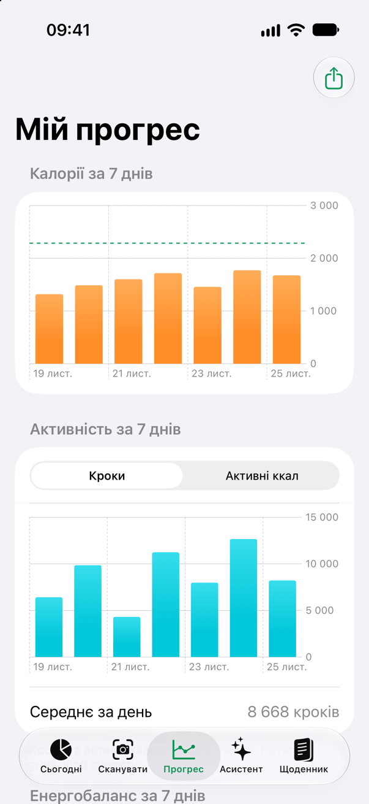
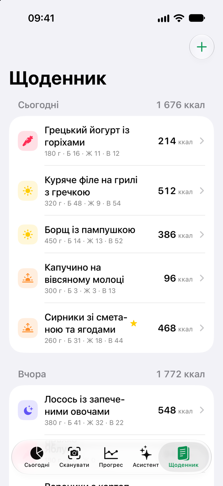
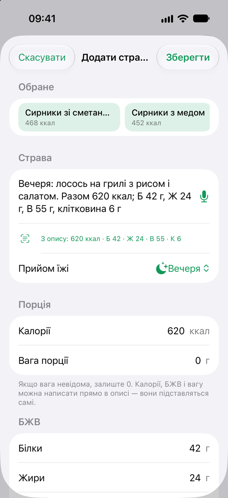
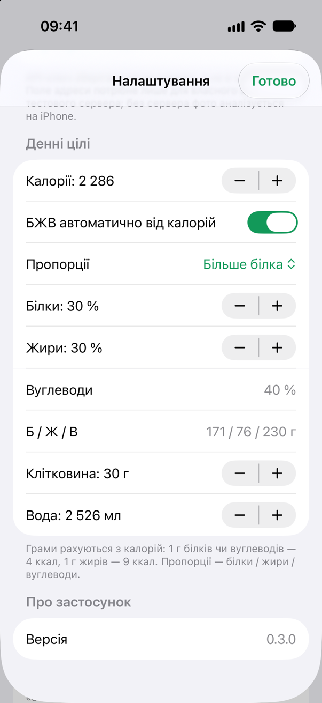
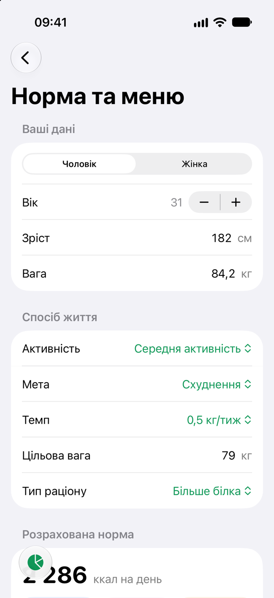
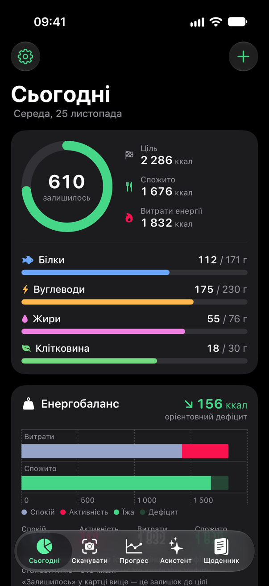

# FoodLens


FoodLens — нативний iOS-застосунок для обліку харчування з AI-розпізнаванням страв за фото, розрахунком енергобалансу на основі Apple Health і підбором рецептів із наявних продуктів. Інтерфейс українською мовою.

Репозиторій містить два компоненти: iOS-клієнт на SwiftUI та сервер на FastAPI. Сервер зберігає API-ключі й звертається до мовних моделей. Щоденник, цілі та аналітика працюють і без нього.

| | |
| --- | --- |
| Версія | 0.3.2 |
| Платформа | iOS 17+, iPhone |
| Мова | Swift 6 (strict concurrency) |
| Сервер | Python 3.12, FastAPI, Docker |
| AI | Claude (Anthropic), OpenAI, Gemini — на вибір |

## Демо та вихідний код

**[Вихідний код FoodLens](https://github.com/F-Andersen/FoodLens)**. Це нативний iOS-застосунок; публічне вебдемо інтерфейсу не опубліковано. Для запуску в Xcode та перегляду демо-даних скористайтеся інструкціями нижче.

## Зміст

- [Можливості](#можливості)
- [Скриншоти](#скриншоти)
- [Архітектура](#архітектура)
- [Технології](#технології)
- [Структура репозиторію](#структура-репозиторію)
- [Запуск](#запуск)
- [Розрахунки](#розрахунки)
- [Дані та приватність](#дані-та-приватність)
- [Тестування](#тестування)
- [Обмеження](#обмеження)
- [Ліцензія](#ліцензія)

## Можливості

### Розпізнавання страв

- Знімок камерою (AVFoundation) або вибір фото з галереї.
- Серверний аналіз мовною моделлю: назва страви, склад із грамовками, калорії, білки, жири, вуглеводи та клітковина. Промпт враховує особливості української кухні.
- Підсумкові показники сервер рахує з інгредієнтів, тому вони завжди узгоджені зі складом.
- Якщо назву розпізнано неточно, страву можна перерахувати за виправленою назвою та описом складу.
- Без сервера застосунок класифікує фото локально через Apple Vision.

### Щоденник

- Записи за прийомами їжі з вагою порції, калоріями та БЖВ.
- Пошук, обране, редагування з пропорційним перерахунком при зміні ваги.
- Ручне додавання та голосове введення українською.
- Розбір опису: калорії, Б/Ж/В, клітковина, вага порції та прийом їжі підставляються з тексту на зразок «Разом 620 ккал; Б 42 г, Ж 24 г, В 55 г». Поля, змінені вручну, не перезаписуються.

### Енергобаланс

- Енергія спокою та активні калорії з Apple Health. Якщо даних Health немає, застосунок оцінює енергію спокою за профілем і явно показує джерело.
- Орієнтовний дефіцит або профіцит на поточний момент і прогноз на кінець дня.
- Тренування не додаються до активної енергії вдруге, бо вже входять у неї.
- Значення на екрані завжди сходяться арифметично: кожна складова округлюється один раз, а підсумки будуються з округлених складових.
- Залишок до цілі харчування показано окремо від енергетичного дефіциту.

### Цілі та персоналізація

- Профіль: стать, вік, зріст, вага, рівень активності, мета, бажаний темп (0,25–1 кг на тиждень), цільова вага, тип раціону.
- Базовий обмін за формулою Міффліна — Сан Жеора, добові витрати, дефіцит відповідно до темпу, орієнтовний строк досягнення цілі.
- Два режими цілей БЖВ:
  - автоматичний — грами розраховуються від калорій за пропорціями (пресети або власні відсотки);
  - ручний — грами задає користувач; невідповідність калорійній цілі показується з пропозицією перерахунку, але без автоматичної зміни.
- Попередження про надмірний дефіцит без обмеження введених даних.

### Аналітика

- Калорії, кроки та активні калорії за 7 днів.
- Тижневий енергобаланс: середнє споживання, середні витрати, орієнтовний дефіцит, орієнтовна зміна ваги.
- Тренд БЖВ за тиждень у порівнянні з цілями.
- Графік ваги з лінією цільової ваги.
- PDF-звіт за 30 днів.

### Асистент рецептів

- Підбір рецептів із продуктів у холодильнику з урахуванням залишку калорій і білка, типу раціону та виключених продуктів.
- Рецепти з грамовками, калорійністю, часом приготування та кроками; список продуктів, які треба докупити.
- Якщо сервер недоступний, асистент використовує вбудований каталог рецептів.

### Інтерфейс

- Єдина дизайн-система, світла й темна теми, Dynamic Type, VoiceOver-підписи.
- Системна панель вкладок, на iOS 26 — Liquid Glass.
- Онбординг із розрахунком персональної норми.

## Скриншоти



| Сьогодні | Енергобаланс і активність | Прийоми їжі та вода |
| :---: | :---: | :---: |
|  |  |  |
| **Прогрес** | **Енергобаланс за тиждень** | **БЖВ за тиждень** |
|  |  |  |
| **Вага та ціль** | **Асистент** | **Рецепти** |
|  |  |  |
| **Рецепт** | **Щоденник** | **Ручне додавання** |
|  |  |  |
| **Денні цілі** | **Профіль** | **Норма та меню** |
|  |  |  |
| **Онбординг** | **Сьогодні, темна тема** | **Прогрес, темна тема** |
|  |  |  |

Скриншоти зроблено в симуляторі iPhone 17 на демонстраційних даних (див. [Демонстраційний режим](#демонстраційний-режим)). Рецепти на екранах згенеровані робочим сервером.

## Архітектура

```text
┌──────────────────────────── iPhone ────────────────────────────┐
│  SwiftUI (Features/*)                                          │
│     │                                                          │
│  DiaryStore (@Observable) ── SwiftData: страви, вага, вода     │
│  HealthService ───────────── HealthKit: енергія, кроки, кільця │
│  Моделі розрахунків ──────── EnergyBalance, NutritionGoals,    │
│                              MealTextParser, GoalProgress      │
│  FoodLensAPI (actor) ─────── токен пристрою в Keychain         │
└───────────────┬────────────────────────────────────────────────┘
                │ HTTPS, Bearer-токен
┌───────────────▼──────────── FastAPI ───────────────────────────┐
│  /v1/auth/register  /v1/analyze  /v1/recipes  /health          │
│  HMAC-токени · ліміти запитів · валідація структурованих       │
│  відповідей (Pydantic) · перерахунок підсумків з інгредієнтів  │
└───────────────┬────────────────────────────────────────────────┘
                │
        Claude · OpenAI · Gemini (AI_PROVIDER)
```

- Уся бізнес-логіка розрахунків винесена в моделі без залежностей від UI та HealthKit, тому покрита модульними тестами.
- API-ключі ніколи не потрапляють у застосунок: клієнт отримує анонімний токен пристрою, сервер перевіряє його та застосовує ліміти.
- Відповіді моделей обмежені JSON-схемою (structured output) і повторно валідуються на сервері.

Опис API, безпеки та розгортання — у [backend/README.md](backend/README.md).

## Технології

| Шар | Технології |
| --- | --- |
| Інтерфейс | SwiftUI, Swift Charts, UIKit (окремі компоненти) |
| Дані | SwiftData з версіонованою схемою, UserDefaults, Keychain |
| Системні інтеграції | HealthKit, AVFoundation, PhotosUI, Vision, Speech |
| Мережа | URLSession, async/await, Swift Concurrency (actor) |
| Тести | Swift Testing |
| Сервер | Python 3.12, FastAPI, Pydantic, HTTPX, Uvicorn |
| AI | Anthropic SDK, OpenAI Responses API, Gemini API |
| Інфраструктура | Docker Compose, nginx або Caddy, Let's Encrypt, GitHub Actions |

Проєкт не має сторонніх Swift-залежностей. Групи файлів у Xcode синхронізуються з папками.

## Структура репозиторію

```text
FoodLens/
├── App/                 точка входу, кореневі вкладки, демонстраційні дані (Debug)
├── Features/            екрани: Dashboard, Scan, Diary, Progress, Plan, Assistant, Settings, Onboarding
├── Models/              доменні моделі та розрахунки
├── Persistence/         SwiftData-схема, DiaryStore, міграція даних попередніх версій
├── Services/            камера, Vision, HealthKit, диктування, клієнт API
├── Shared/              дизайн-система, PDF-звіт
└── Assets.xcassets      іконка застосунку, AccentColor
FoodLensTests/           модульні тести
backend/                 сервер FastAPI, Docker, конфігурації розгортання, тести pytest
docs/screenshots/        зображення для документації
.github/workflows/       CI сервера
```

## Запуск

### iOS-застосунок

Вимоги: Xcode 26 або новіший, iOS 17+.

1. Відкрийте `FoodLens.xcodeproj`, схема `FoodLens`.
2. У Signing & Capabilities оберіть свою команду розробника та унікальний Bundle Identifier.
3. Запустіть на симуляторі або iPhone. Камеру, диктування та Apple Health варто перевіряти на фізичному пристрої.

Збірка з командного рядка:

```bash
xcodebuild -project FoodLens.xcodeproj -scheme FoodLens \
  -destination 'generic/platform=iOS Simulator' CODE_SIGNING_ALLOWED=NO build
```

### Сервер

Для локальної розробки сервер запускається з тестовим провайдером, без API-ключів:

```bash
cd backend
docker build -t foodlens-api .
docker run --rm -p 8000:8000 -e AI_PROVIDER=mock -e AUTH_SECRET=$(openssl rand -hex 32) foodlens-api
```

Адресу сервера можна вказати в застосунку: Налаштування → AI-сервер. Для робочого розгортання (VPS, HTTPS, nginx або Caddy) дивіться [backend/README.md](backend/README.md).

### Демонстраційний режим

Debug-збірка підтримує прапорці запуску для демонстрацій і скриншотів. Дані зберігаються лише в пам'яті й не впливають на справжній щоденник. У Release-збірку цей код не потрапляє.

| Прапорець | Призначення |
| --- | --- |
| `-demoData` | тиждень записів харчування, історія ваги, вода, профіль і цілі |
| `-demoHealth` | демонстраційні дані Apple Health |
| `-startTab N` | відкриття вкладки за індексом 0–4 |
| `-demoOnboarding -onboardingCompleted NO` | показ онбордингу |
| `-demoManualText "…"` | заповнення опису в ручному додаванні |

```bash
xcrun simctl launch booted com.argusstrauf.foodlens -demoData -demoHealth -onboardingCompleted YES -startTab 2
```

## Розрахунки

| Показник | Формула |
| --- | --- |
| Базовий обмін (BMR) | Міффлін — Сан Жеор: `10·вага + 6,25·зріст − 5·вік + 5` (чоловіки) або `− 161` (жінки) |
| Добові витрати | `BMR × коефіцієнт активності` (1,2–1,725) |
| Ціль калорій | `добові витрати ± темп × 7700 / 7`, не нижче 1200 (жінки) або 1500 ккал (чоловіки) |
| БЖВ з калорій | білки та жири — `калорії × частка / 4` і `/ 9`, вуглеводи — решта енергії `/ 4` |
| Енергобаланс | `дефіцит = (енергія спокою + активні калорії) − спожито` |
| Порція | калорії та БЖВ масштабуються пропорційно вазі; вага 0 означає «невідома» |

Розрахунки виконуються з повною точністю, округлення застосовується лише під час показу. Енергія спокою за профілем розподіляється пропорційно до частки доби, що минула, з урахуванням переходів на літній і зимовий час. Дефіцит і прогноз зміни ваги позначено як орієнтовні.

## Дані та приватність

- Щоденник, вага та вода зберігаються локально у SwiftData. Схема версіонована, а дані попередніх версій переносяться автоматично без видалення оригіналу.
- Apple Health використовується лише для читання.
- У серверному режимі на сервер надсилається фото, зменшене до 1280 px. Облікових записів і серверного зберігання щоденника немає.
- Токен пристрою зберігається в Keychain. Застосунок містить Privacy Manifest.

## Тестування

```bash
xcodebuild -project FoodLens.xcodeproj -scheme FoodLens \
  -destination 'platform=iOS Simulator,name=iPhone 17' test
```

131 модульний тест (Swift Testing) покриває:

- розрахунок норми, узгодженість БЖВ з калоріями, збереження ручних цілей;
- енергобаланс: округлення, відсутні дані, застарілі дані Health, переходи часу, подвійний облік тренувань;
- розбір тексту ручного додавання;
- масштабування порцій, оновлення денних підсумків, групування за днями та часовими поясами;
- сховище та міграцію даних, клієнт API, асистента, PDF-звіт.

Сервер має окремий набір тестів pytest (`backend/tests`), який запускається в GitHub Actions.

## Обмеження

- Оцінка калорій за фото є наближеною: модель не вимірює вагу й об'єм, тому важливо перевіряти порцію.
- Витрати енергії — оцінка Apple Health або формули BMR, тому енергобаланс орієнтовний.
- Калорії з ручного опису підставляються лише тоді, коли числа вказано в тексті.
- Застосунок не записує дані в Apple Health і не синхронізує щоденник між пристроями.
- Розрахунки призначені для дорослих і не враховують медичні стани; за потреби дефіцит слід узгодити з лікарем.

## Ліцензія

Ліцензію ще не визначено. Усі права належать автору.
