# FoodLens

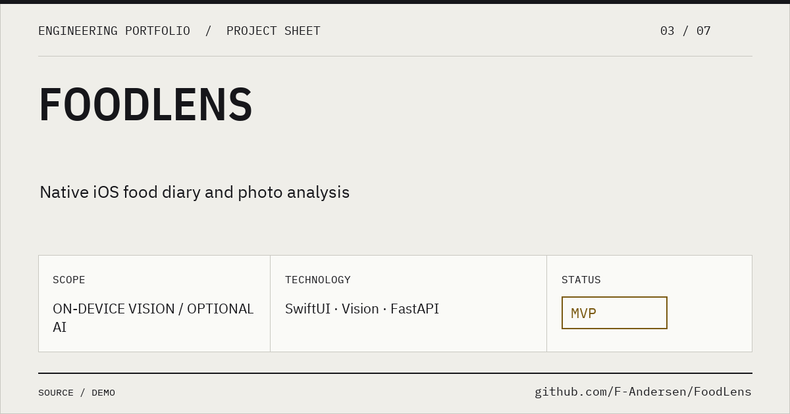

**FoodLens** — нативний iOS-застосунок українською мовою для обліку харчування. Ви фотографуєте страву, AI оцінює калорії та БЖВ, а застосунок рахує живий енергобаланс з даними Apple Health і підбирає рецепти з того, що є в холодильнику.

Проєкт складається з двох частин: iOS-застосунок на SwiftUI та власний сервер на FastAPI. Сервер тримає API-ключі й звертається до Claude, OpenAI або Gemini. Щоденник і базовий облік працюють і без сервера.

**Стек:** Swift 6 · SwiftUI · SwiftData · Swift Charts · HealthKit · Vision · FastAPI · Docker · nginx · Claude API

## Демо та вихідний код

**[Вихідний код FoodLens](https://github.com/F-Andersen/FoodLens)**. Це нативний iOS-застосунок; публічне вебдемо інтерфейсу не опубліковано. Для запуску в Xcode та перегляду демо-даних скористайтеся інструкціями нижче.

## Головне

- 📸 **Фото → калорії та БЖВ.** Страву розбирає Claude з підказками щодо української кухні. Якщо AI помилився з назвою, страву можна перерахувати за виправленою назвою.
- ⚖️ **Живий енергобаланс.** Застосунок рахує орієнтовний дефіцит або профіцит: енергія спокою плюс активні калорії з Apple Health мінус спожите. Тренування не враховуються двічі.
- 🎯 **Узгоджені цілі.** БЖВ автоматично рахуються від калорій за пропорціями: пресети або власні відсотки. Ручні цілі ніколи не перезаписуються без вашої дії.
- ✍️ **Розумне ручне додавання.** Числа з опису («Разом 620 ккал; Б 42 г…») підставляються в поля самі, і під час набору, і під час диктування.
- 🥗 **AI-асистент рецептів.** Він пропонує меню на день із продуктів у холодильнику з урахуванням залишку калорій і білка.
- 📈 **Тижнева аналітика.** Калорії, енергобаланс, тренд БЖВ, графік ваги з ціллю, PDF-звіт.
- 🌙 Світла й темна теми, Liquid Glass на iOS 26, Dynamic Type, 131 модульний тест.

## Екрани


| Сьогодні | Енергобаланс і активність | Прийоми їжі та вода |
| :---: | :---: | :---: |
|  | 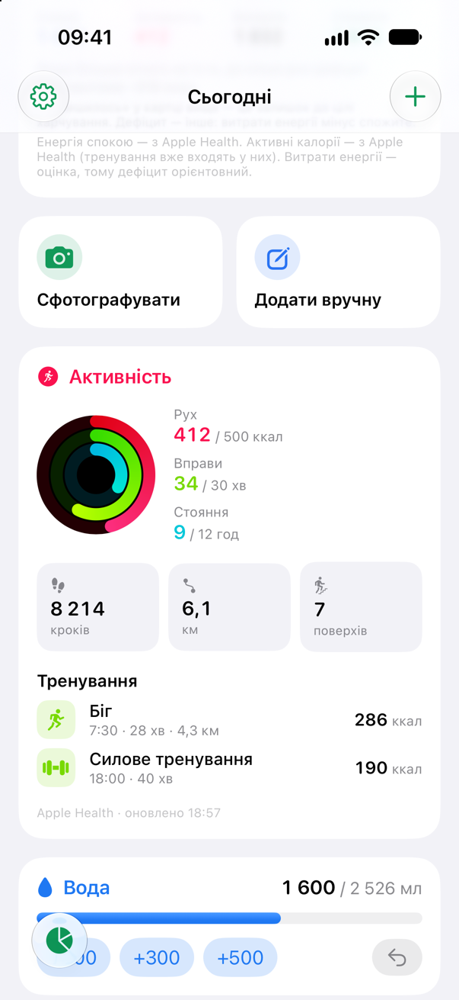 |  |
| **Прогрес** | **Енергобаланс за тиждень** | **БЖВ за тиждень** |
|  | 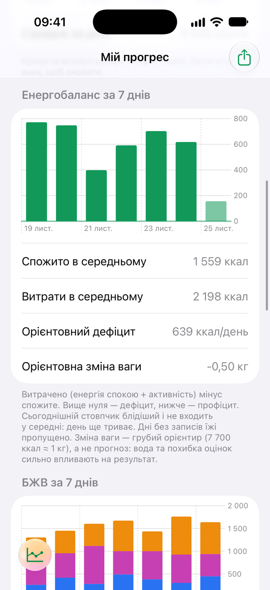 | 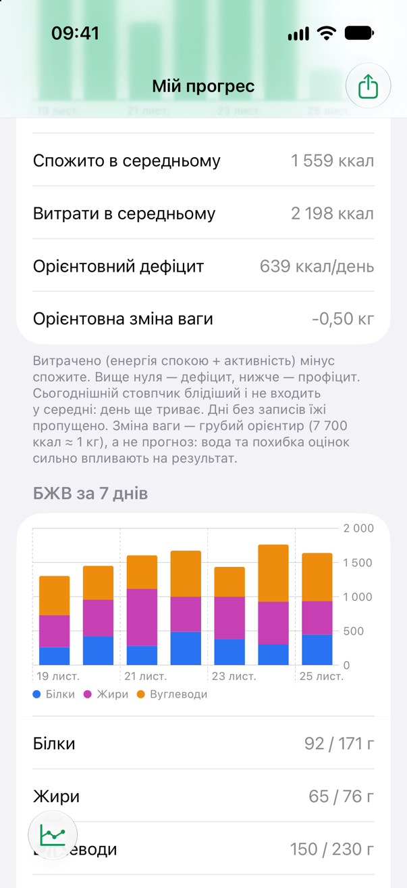 |
| **Вага і ціль** | **AI-асистент** | **Рецепти від AI** |
| 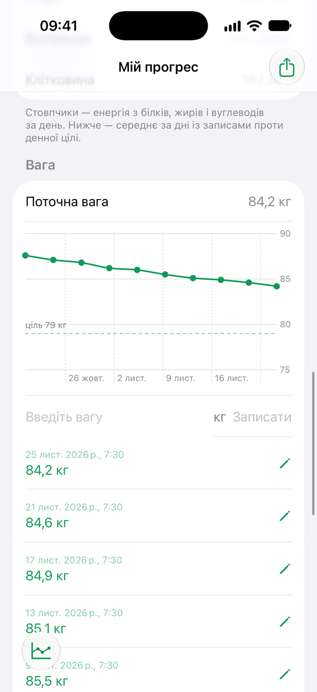 | 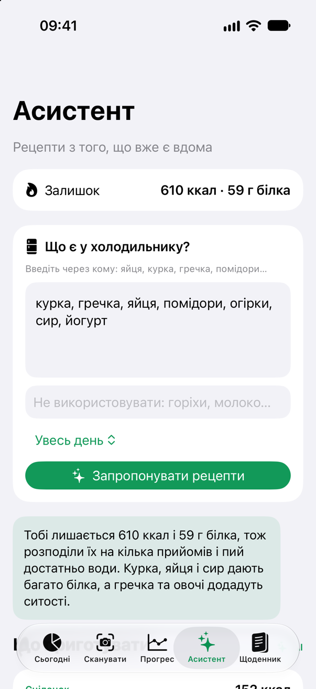 | 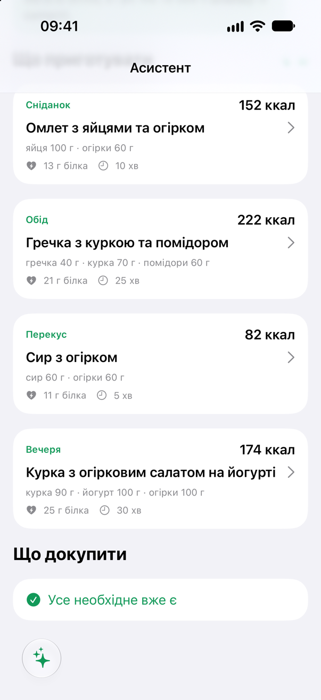 |
| **Рецепт** | **Щоденник** | **Ручне додавання з опису** |
| 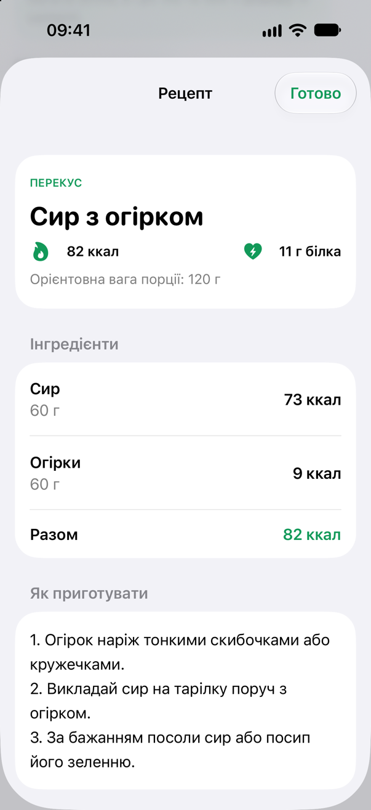 |  |  |
| **Цілі та БЖВ** | **Профіль** | **Норма та меню** |
|  |  | 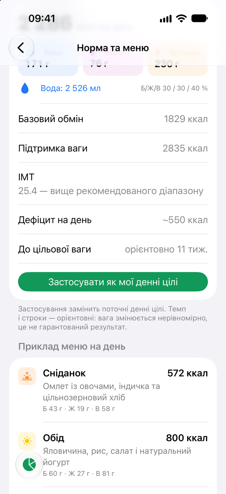 |
| **Онбординг** | **Темна тема** | **Темна тема** |
| 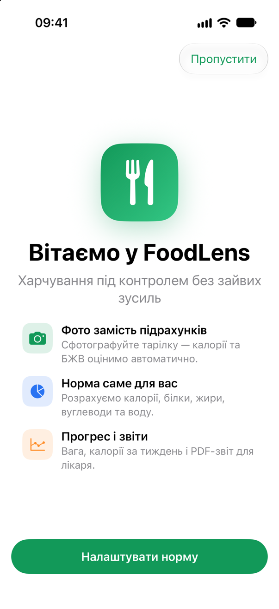 |  | 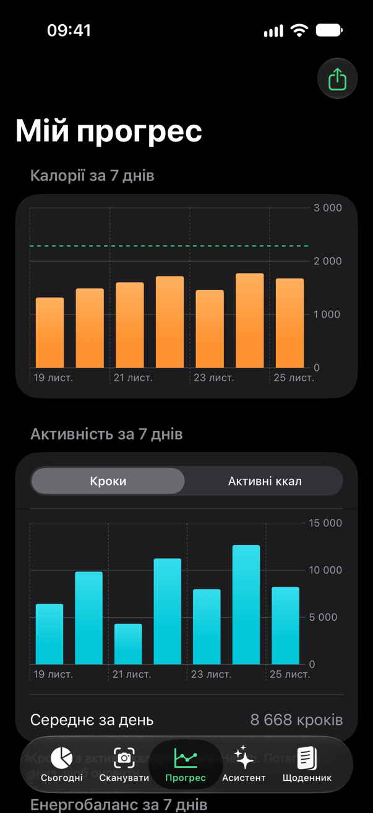 |

Скриншоти зняті в симуляторі iPhone 17 на демо-даних (див. [Демо-режим](#демо-режим-для-скриншотів)).

## Можливості

### Сьогодні

- Кільце калорій: ціль, спожито, залишок до цілі харчування і загальні витрати енергії.
- Смуги білків, жирів, вуглеводів і клітковини. Перевищення показано окремо («Перевищення: +59 г») з міткою цілі на смузі. Надлишок білка чи клітковини підсвічується нейтрально, без тривоги.
- Попередження, якщо цілі БЖВ не сходяться з калоріями.
- Картка «Енергобаланс»:
  - енергія спокою та активні калорії з Apple Health або оцінка за профілем із чітким підписом джерела;
  - орієнтовний дефіцит чи профіцит, прогноз на кінець дня;
  - числа на екрані завжди сходяться: 2336 + 999 = 3335, 3335 − 2530 = 805.
- Кільця активності, кроки, відстань, поверхи та тренування з Apple Health.
- Вода, прийоми їжі за типами, швидке додавання.

### Сканування

- Камера (AVFoundation) або фото з галереї.
- Аналіз на власному сервері: Claude Haiku, OpenAI або Gemini на вибір, з підказками щодо української кухні. Без сервера працює локальний Vision.
- Склад страви з грамовками, редагування ваги з пропорційним перерахунком.
- Виправили назву — кнопка «Перерахувати калорії за новою назвою» робить новий аналіз з уточненням.

### Щоденник і ручне додавання

- Пошук, обране, редагування й видалення записів.
- Ручне додавання та українське диктування. Калорії, Б/Ж/В, клітковина, вага порції та прийом їжі розпізнаються прямо з опису. Поля, змінені руками, не перезаписуються.

### Прогрес

- Калорії й активність за 7 днів.
- Енергобаланс за тиждень: середнє спожите, середні витрати, орієнтовний дефіцит і грубий орієнтир зміни ваги (не прогноз).
- Тренд БЖВ за тиждень проти цілей.
- Графік ваги з лінією цільової ваги, редагування вимірювань, PDF-звіт.

### Норма, цілі та персоналізація

- Профіль: стать, вік, зріст, вага, активність, мета, темп (0,25–1 кг/тиж), цільова вага, тип раціону.
- Базовий обмін за Міффліном — Сан Жеором, підтримка ваги, дефіцит від темпу, орієнтовний строк до цілі.
- Попередження про надмірний дефіцит: якщо ціль нижча за базовий обмін або дефіцит перевищує 25 % від підтримки. Введені вами дані застосунок не обмежує.
- Денні цілі:
  - БЖВ автоматично від калорій за пропорціями (пресети або власні відсотки, 4/9/4 ккал на грам);
  - або ручні грами з попередженням і кнопкою перерахунку, що зберігає ваші пропорції.

### Асистент

- Продукти з холодильника, виключення, прийом їжі або весь день.
- Рецепти від AI з грамовками, калоріями, білком і кроками; список того, що треба докупити.
- Якщо сервер недоступний, асистент бере рецепти з вбудованого каталогу.

## Як працює розпізнавання

### Локальний режим

Apple Vision класифікує зображення через `VNClassifyImageRequest`. Результати зіставляються з двадцятьма профілями: піца, бургер, сендвіч, салат, суп, паста, рисова страва, суші, яловичина, курка, риба, омлет, каша, випічка, десерт, картопля, яблуко, банан, фрукти, овочі.

Сервіс перевіряє перші 30 класифікацій та вибирає найвпевненішу відповідну категорію з порогом 0,08. За відсутності відповідної категорії показує помилку.

Назва категорії та впевненість залежать від фото. Початкова вага, калорійність і БЖВ беруться з довідкового профілю категорії. Це не вимірювання ваги чи складу зображення: різні фото однакової категорії можуть мати однакові початкові показники.

### Серверний режим

Застосунок працює з сервером, якщо адреса задана в `AppConfig.defaultAPIBaseURL` або вказана в налаштуваннях. Як це відбувається:

1. При першому зверненні застосунок реєструє встановлення й зберігає токен у Keychain. Якщо сервер відхиляє токен, застосунок автоматично реєструється знову.
2. Фото зменшується до 1280 px і надсилається на `POST /v1/analyze`.
3. Сервер звертається до Claude, OpenAI або Gemini (обирається змінною `AI_PROVIDER`) і повертає перевірену оцінку страви з інгредієнтами. Підсумкові калорії й БЖВ сервер рахує з інгредієнтів, щоб вони завжди збігалися.

Асистент так само отримує рецепти через `POST /v1/recipes`. Сервер враховує продукти в холодильнику, залишок калорій і білка, тип раціону та продукти, які треба виключити.

API-ключі є лише на сервері. Якщо сервер недоступний, застосунок переходить на Vision або вбудований каталог рецептів і показує зрозуміле повідомлення. Перевірити з'єднання можна в налаштуваннях. Деталі, ліміти й розгортання на VPS описано в [backend/README.md](backend/README.md).

## Технології

| Частина | Стек |
| --- | --- |
| Інтерфейс | Swift, SwiftUI, UIKit |
| Камера та фото | AVFoundation, PhotosUI |
| Розпізнавання | Vision, необов’язковий серверний аналіз |
| Графіки | Swift Charts |
| Активність | HealthKit |
| Диктування | Speech, AVAudioEngine |
| Збереження | SwiftData (щоденник, вага, вода), UserDefaults (цілі, профіль), AppStorage |
| Мережа | URLSession, async/await |
| PDF | UIGraphicsPDFRenderer, UIActivityViewController |
| Тести | Swift Testing (`FoodLensTests`) |
| Сервер | Python 3.12, FastAPI, Pydantic, Anthropic SDK, HTTPX, Uvicorn, Docker, nginx/Caddy, Let's Encrypt |

Мінімальна ціль — **iOS 17.0**. Проєкт компілюється в режимі **Swift 6** зі строгою перевіркою конкурентності. Групи файлів синхронізуються з папками (Xcode 16+): нові файли в `FoodLens/` і `FoodLensTests/` потрапляють у таргет без редагування `project.pbxproj`. Зовнішніх Swift Package залежностей немає.

## Структура

```text
FoodLens/
├── App/                    # Точка входу, корінь навігації та вкладки
├── Features/               # Екрани: Onboarding, Dashboard, Scan, Diary, Progress, Plan, Assistant, Settings
├── Models/                 # MealEntry, цілі, профіль, план меню, локальний асистент
├── Persistence/            # SwiftData-схема, DiaryStore, міграція даних v0.2
├── Services/               # Камера, Vision, клієнт API (токен у Keychain), HealthKit, диктування
├── Shared/                 # Дизайн-система (кольори, відступи, компоненти), PDF-звіт
├── Assets.xcassets         # Іконка застосунку (світла й темна) та AccentColor
├── PrivacyInfo.xcprivacy   # Privacy manifest для App Store
└── FoodLens.entitlements   # HealthKit capability
FoodLensTests/              # Модульні тести (Swift Testing)
FoodLens.xcodeproj/         # Xcode-проєкт і спільна схема FoodLens
backend/                    # FastAPI: аналіз фото, рецепти, токени, ліміти, Docker + Caddy
.github/workflows/          # CI: тести бекенду та збірка Docker-образу
```

## Запуск застосунку

1. Встановіть Xcode з підтримкою потрібної версії iOS.
2. Відкрийте `FoodLens.xcodeproj` та виберіть схему `FoodLens`.
3. У target → Signing & Capabilities виберіть власну команду розробника.
4. Установіть власний унікальний Bundle Identifier.
5. Перевірте доступність HealthKit capability для команди й профілю підпису.
6. Виберіть симулятор або підключений iPhone та натисніть Run.

Для iPhone потрібні довіра до комп’ютера, Developer Mode і коректний підпис. Камеру, диктування й Apple Health перевіряйте на фізичному пристрої.

Збірка для симулятора:

```bash
xcodebuild -project FoodLens.xcodeproj \
  -scheme FoodLens \
  -destination 'generic/platform=iOS Simulator' \
  CODE_SIGNING_ALLOWED=NO build
```

Сервер необов’язковий. Для розробки запустіть його локально в Docker з `AI_PROVIDER=mock` і вкажіть `http://localhost:8000` у «Сьогодні» → налаштування → «AI-сервер». Для релізу розгорніть його на VPS і впишіть адресу в `AppConfig.defaultAPIBaseURL`.

## Демо-режим для скриншотів

У Debug-збірці є прапорці запуску, які не чіпають справжній щоденник (дані живуть у пам'яті):

| Прапорець | Що робить |
| --- | --- |
| `-demoData` | тиждень українських страв, вага за 6 тижнів, вода, профіль і цілі |
| `-demoHealth` | реалістичні дані Apple Health (кроки, кільця, тренування, енергія спокою) |
| `-startTab N` | відкриває вкладку 0–4 |
| `-demoOnboarding -onboardingCompleted NO` | показує онбординг |
| `-demoManualText "..."` | заповнює опис у ручному додаванні |

```bash
xcrun simctl launch booted com.argusstrauf.foodlens -demoData -demoHealth -onboardingCompleted YES -startTab 2
```

## Збереження та приватність

Страви, вимірювання ваги та записи води зберігаються у SwiftData (`DiaryStore`, схема `FoodLensSchemaV1`). Схема версіонована, а всі поля мають значення за замовчуванням, тож у майбутньому можна додати міграції та синхронізацію через iCloud. Денні цілі та анкета калькулятора зберігаються в UserDefaults.

Під час першого запуску v0.3 дані з попередніх версій (`foodlens_store_v2`, `meal_diary_v1`) переносяться автоматично:

- Старі записи не видаляються, а залишаються як резервна копія.
- Пошкоджений запис пропускається, решта переноситься.
- Якщо старі дані не вдається прочитати взагалі, вони не перезаписуються, а застосунок показує попередження.
- Міграція позначається завершеною лише після успішного збереження.

Якщо сховище не відкривається, застосунок працює в пам'яті й попереджає про це, не чіпаючи старих даних.

Продукти асистента та URL сервера зберігаються через AppStorage. Реєстрація, серверна база щоденника та синхронізація між пристроями відсутні. У локальному режимі фото обробляє Vision на пристрої. У серверному режимі зменшене до 1280 px фото надсилається налаштованому серверу, а звідти — зовнішньому постачальнику аналізу.

## Розрахунки та обмеження

Калорії порції:

```text
калорії = вага_г × ккал_на_100_г / 100
```

Запис щоденника зберігає калорії, БЖВ і клітковину всієї порції. Значення на 100 г обчислюється з ваги. Вага 0 означає «невідома», наприклад для страв із плану меню.

Зміна ваги в сканері та в редакторі (якщо увімкнено перемикач) пропорційно перераховує калорії, БЖВ, клітковину та інгредієнти.

Поточні обмеження:

- Локальна модель визначає категорію; виділення всіх інгредієнтів, вимірювання об’єму та фізичної маси не реалізовані.
- Впевненість класифікатора не є точністю оцінки калорій.
- Меню використовує шаблони та розподіл цілей, а не точні ваги продуктів, тому записи меню мають невідому вагу.
- Асистент не обробляє алергії, запаси в грамах або довільні дієтичні обмеження.
- PDF охоплює останні 30 днів: середні показники, зміну ваги та всі страви по днях.
- HealthKit лише читає дані (кроки, активну енергію та енергію спокою, тренування, кільця); запис харчування або ваги в Apple Health відсутній.
- Енергобаланс — оцінка: витрати енергії з Apple Health і формули BMR мають похибку, тому дефіцит позначено як орієнтовний.
- Калорії з ручного опису підставляються лише тоді, коли числа написано в тексті; калорійність за назвами продуктів без сервера не оцінюється.

## Тести

131 модульний тест (Swift Testing). Вони покривають міграцію даних v0.2, сховище, розрахунки норми й узгодженість БЖВ, енергобаланс (округлення, переходи на літній час, застарілі дані Health, подвійний облік тренувань), розбір тексту ручного додавання, масштабування порцій, Vision, клієнт AI-сервера, асистента й PDF-звіт. Серверна частина має власні тести pytest (`backend/tests`).

```bash
xcodebuild -project FoodLens.xcodeproj -scheme FoodLens \
  -destination 'platform=iOS Simulator,name=iPhone 17' test
```

## Сценарії ручної перевірки

1. Додати страву вручну й перевірити денний підсумок.
2. Відредагувати калорії та БЖВ через щоденник, перевірити підсумки.
3. Розпізнати фото різних категорій, перевірити назву та режим.
4. Уточнити назву, склад і вагу, зберегти запис.
5. Додати вагу з комою, відредагувати й видалити вимірювання.
6. Ввести продукти, відкрити рецепт, перевірити список покупок.
7. Перейти між вкладками й перезапустити застосунок, перевірити збереження.
8. Сформувати PDF і відкрити його через меню поширення.
9. На iPhone перевірити дозволи камери, мікрофона, мовлення й HealthKit.
10. За налаштованого сервера перевірити аналіз і перехід до Vision за недоступності сервера.

Це перелік перевірок для розробника, а не звіт про автоматично пройдені тести.

## Публікація

До GitHub додаються вихідні файли, Xcode-проєкт зі спільною схемою, серверний код та документація. `.gitignore` виключає збірки, персональні налаштування Xcode, тимчасові файли, Python-середовища та локальні секрети.

У проєкті є параметри авторського підпису: для власної збірки змініть Team і Bundle Identifier.

Ліцензію наразі не визначено. Перед поширенням як open source автор має вибрати ліцензію й додати `LICENSE`.
